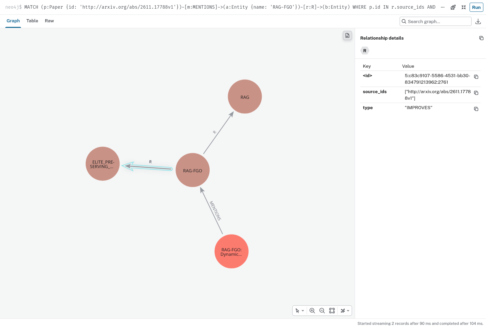
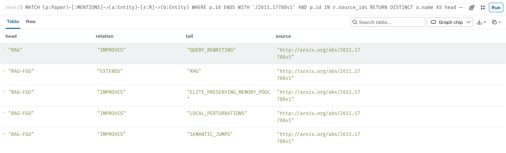

# Сохранённый прогон: что показать на экране

Для показа без запуска: сначала одна запись извлечения и фрагмент графа, затем два ответа из сохранённого прогона.

## Что получилось при извлечении

Одна реальная статья — [RAG-FGO, `2611.17788v1`](https://arxiv.org/abs/2611.17788v1). Для неё в [`triplets.jsonl`](data/triplets.jsonl#L467) сохранены **6 сущностей и 5 отношений**. Ниже два скриншота запросов на чтение из **работающего Neo4j Browser**. Запускать базу на ревью не нужно.

### Граф: статья, сущности и источник связи

На снимке только фрагмент графа. Покажи стрелку `MENTIONS` от статьи к `RAG-FGO`, затем выделенное ребро `R`. Справа видно, что `R` — тип ребра в Neo4j, `type: IMPROVES` — извлечённое утверждение, а `source_ids` хранит полный URL статьи.

### Таблица: все пять извлечённых отношений

Покажи третью строку: модель записала `RAG-FGO IMPROVES ELITE_PRESERVING_MEMORY_POOL`. В [аннотации](data/papers.json#L2350) сказано **introduces** — метод **вводит** пул памяти, а пул помогает оптимизации. Из этого не следует, что метод **улучшает сам пул**.

**Что сказать:** «Это не нарисованная схема и не вручную придуманные связи: я прочитал данные из Neo4j. `MENTIONS` означает, что статья упоминает сущность. `source_ids` означает, что из статьи извлекли это утверждение. Оно может быть неверным, даже когда источник указан правильно».

## Один вопрос, два ответа

**Вопрос:** “What does RAG-FGO optimize, and how does its memory pool help?”

**Первый найденный источник:** `2611.17788v1`, *RAG-FGO: Dynamic Optimization of Query-Rewriting Agents for Generative RAG*. В сохранённом контексте `matched_names` содержит `rag-fgo`. У первичной аннотации формулировка: RAG-FGO **introduces** a memory pool, который накапливает удачные стратегии и уменьшает влияние шумной обратной связи.

**Без графовых связей — начало ответа:**

> RAG-FGO optimizes generative retrieval strategies, specifically focusing on query rewriting. Its memory pool helps by accumulating high-quality strategies across iterations, which mitigates the impact of stochasticity and noisy feedback on optimization stability.

**С графовыми связями — полный ответ:**

> RAG-FGO optimizes query rewriting as a non-differentiable black-box optimization problem in a mixed discrete-continuous space. Its memory pool helps by introducing an elite-preserving memory pool that accumulates high-quality strategies across iterations, thereby mitigating the impact of stochasticity and noisy feedback on optimization stability.

Вариант с графом подробнее формулирует задачу оптимизации, но оба передают основную пользу пула. **Ни в одном нет URL.** Наличие источника в контексте не гарантирует его цитирование в ответе.

## Итог по пяти вопросам

| Показатель | Без связей | Со связями |
|---|---:|---:|
| Успешные вызовы | 5/5 | 5/5 |
| Остановка по лимиту ответа | 0 | 0 |
| Ответы со ссылкой на найденную статью, среди вопросов с ожидаемым источником | 1/4 | 1/4 |
| Среднее время этапа генерации | 28,6 с | 47,4 с |

Ожидаемая статья в топ-3 у **4 из 4** вопросов с ожидаемой статьёй. В обоих режимах модель не стала выдумывать актуальную цену видеокарты. Содержательный разбор с помощью ИИ не обнаружил явного выигрыша графа; набор маленький, не отложенный, не независимый. Время относится к генерации у клиента в том прогоне; оно включает эффекты загрузки и кеша, а не измеряет полную задержку API. В прогоне использовали `num_predict=256`; в копии текущего кода — `1024`.

**Пример, почему попадания в топ-3 недостаточно.** В вопросе про Bioformer обе версии нашли и процитировали нужную статью, но обе перепутали «у модели около 40% от исходного числа параметров» с «у модели на 40% меньше параметров». Если было 100 и осталось 40, стало **на 60% меньше**. Правильная ссылка не делает вывод правильным.

**Откуда взяты цифры:** [исходный отчёт с промптами и ответами](https://github.com/P0dp1vass/graphrag-papers/blob/main/data/evaluations/graph_eval_20261125_152620_112169.json) и [поопросный разбор](https://github.com/P0dp1vass/graphrag-papers/blob/main/data/evaluations/graph_eval_20261125_152620_112169.review.json). Разбор делал тот же ИИ-помощник, который участвовал в разработке; это не слепая экспертная оценка.
